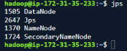
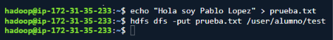
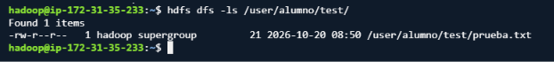
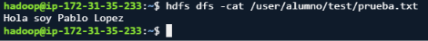
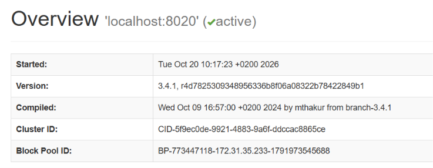
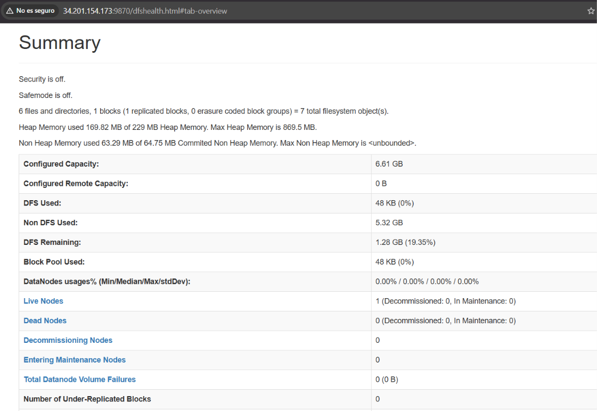
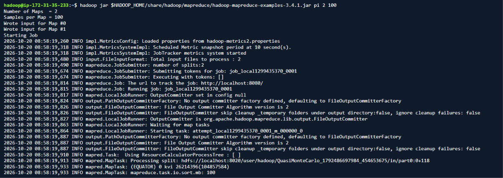
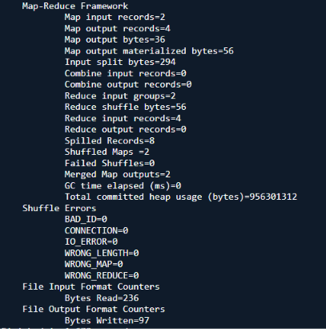

# PR0201: Instalación y configuración de Hadoop en modo pseudo-distribuido

## Objetivo

El objetivo de esta práctica es demostrar la correcta instalación, configuración y puesta en marcha de Apache Hadoop en modo pseudo-distribuido sobre una instancia remota en AWS, verificando la disponibilidad de los demonios del clúster y el funcionamiento básico del sistema de archivos distribuido (HDFS).

Esta instalación se debe realizar sobre una instancia de AWS EC2.

## Evidencias a incluir en la entrega

El documento de entrega debe centrarse exclusivamente en demostrar la autoría y el correcto funcionamiento del entorno. Cada captura debe mostrar de forma legible el **prompt de la terminal**, donde se aprecie el usuario, el nombre de la máquina o la IP de la instancia remota asignada.

### 1. Conexión y estado de los servicios

Realiza una captura de la sesión SSH abierta en la máquina remota ejecutando el siguiente comando. Debe mostrarse la presencia de los procesos activos de Hadoop: NameNode, DataNode, SecondaryNameNode, ResourceManager y NodeManager.

```bash
jps
```



### 2. Prueba funcional en HDFS

Realiza una captura de terminal ejecutando un ciclo de operaciones básicas sobre HDFS.

**1. Creación de un directorio personal:**

```bash
hdfs dfs -mkdir -p /user/alumno/test
```


**2. Subida de un fichero de texto local con contenido personalizado:**

```bash
hdfs dfs -put prueba.txt /user/alumno/test/
```


**3. Listado del directorio y visualización del contenido almacenado:**

```bash
hdfs dfs -ls /user/alumno/test/
hdfs dfs -cat /user/alumno/test/prueba.txt
```




### 3. Interfaz web del NameNode

Realiza una captura del navegador accediendo a la consola web de Hadoop HDFS mediante la siguiente dirección:

```text
http://<IP_PUBLICA_EC2>:9870
```

También se puede acceder mediante un túnel SSH.

En la captura debe apreciarse la pestaña **Overview**, con el estado del clúster y la siguiente información:

- **Live Nodes = 1**
- Capacidad disponible en HDFS.

#### Como no se puede acceder a la consola web con el internet del centro, lo haré con el mio propio 





### 4. Verificación de MapReduce

Para comprobar que Hadoop ejecuta correctamente tareas distribuidas, ejecuta el cálculo de aproximación de π mediante el método cuasi-Monte Carlo incluido en el paquete de ejemplos.

```bash
jar $HADOOP_HOME/share/hadoop/mapreduce/hadoop-mapreduce-examples-3.4.1.jar pi 2 100
```

Incluye una captura con la salida completa del comando, donde se aprecien los siguientes elementos:

- Lanzamiento del trabajo.
- Barra de progreso de las tareas Map y Reduce.
- Resultado final calculado, identificado mediante el mensaje `Estimated value of Pi is...`.





