# PR0202: Uso del cliente HDFS

**ESPECIALIZACIÓN EN INTELIGENCIA ARTIFICIAL Y BIG DATA**

- **Módulo:** BIG DATA APLICADO
- **Profesor:** Víctor J. González
- **Unidad de Trabajo:** UT02. Almacenamiento distribuido e integridad con HDFS
- **Práctica:** PR0202. Uso del cliente HDFS
- **Resultados de aprendizaje:** RA3

---

## Escenario

Eres parte de un equipo de análisis de datos que trabaja con Hadoop. Cada usuario tiene su propio espacio en HDFS para almacenar y organizar datasets. Tu tarea es preparar tu espacio, cargar datos de prueba y practicar operaciones básicas de gestión en HDFS.

## Ejercicios

### 1. Preparación del entorno

- Crea un directorio personal en HDFS bajo `/user` con tu nombre de usuario y dentro de él un directorio llamado `proyecto_datos`.
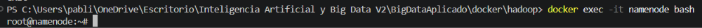
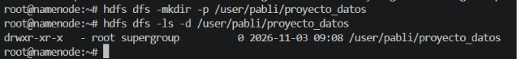

### 2. Carga de datasets

- Descarga el dataset *Automotive Price Prediction Dataset*, que puedes obtener desde [Kaggle](https://www.kaggle.com/datasets/metawave/vehicle-price-prediction).
- El dataset contiene información sintética sobre 1.000.000 de vehículos de segunda mano y sus precios.
- Desde tu sistema local, sube al directorio `proyecto_datos` el dataset que has descargado.
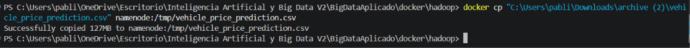
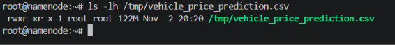
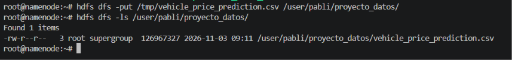

### 3. Exploración de datos

- Visualiza el contenido del archivo directamente en HDFS.
  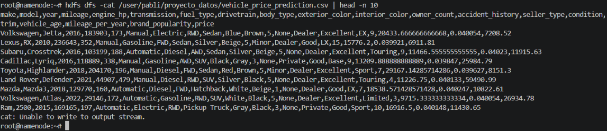
- Obtén el número de líneas del dataset.
  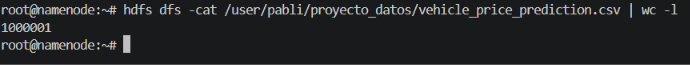

### 4. Organización del proyecto

- Crea un subdirectorio `procesados` y otro `backup` dentro de tu carpeta de proyecto.
  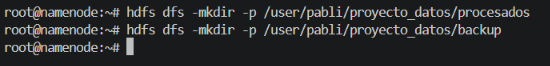
- Copia el archivo original a `backup`.
  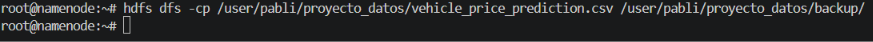
- Mueve el archivo original de `proyecto_datos` a `procesados`.
  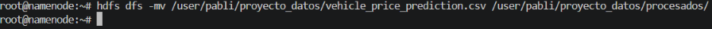

  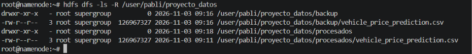

### 5. Colaboración en el equipo

- Crea un directorio compartido bajo `/compartido` (si no existe).
- Copia allí tu dataset para que otros puedan acceder.
  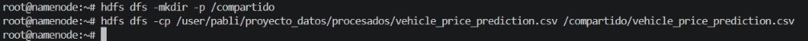
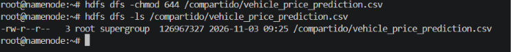
### 6. Recuperación de datos

- Descarga a tu sistema local el archivo que está en el directorio `procesados`.

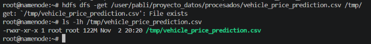
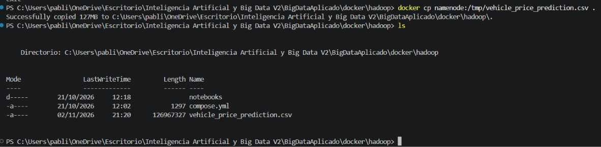

### 7. Control de accesos

- Verifica los permisos de tus archivos.
  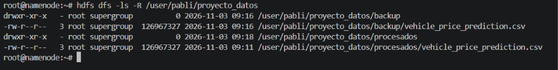
- Cambia los permisos de un archivo de `backup` para que solo tú tengas acceso de lectura y escritura.

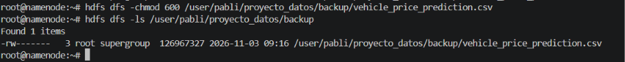

### 8. Mantenimiento

- Elimina un archivo temporal que hayas subido por error a tu espacio en HDFS.

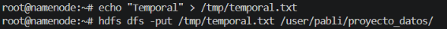
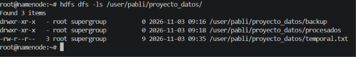
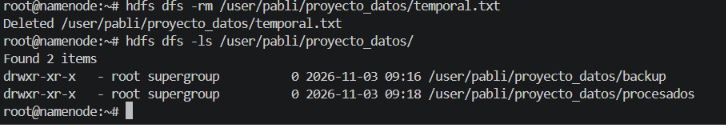
---

## Entrega

Sube a tu repositorio un **documento** que incluya:

- El comando introducido en cada uno de los ejercicios.
- Una muestra de las primeras líneas de la salida de cada comando.

---

[Volver al índice](https://vgonzalez165.github.io/apuntes_bda/)