# ESPECIALIZACIÓN EN INTELIGENCIA ARTIFICIAL Y BIG DATA

---

**Módulo:** BIG DATA APLICADO  
**Profesor:** Víctor J. González  
**Unidad de Trabajo:** UT02. Almacenamiento distribuido e integridad con HDFS  
**Práctica:** PR0203. Uso del cliente HDFS (2)  
**Resultados de aprendizaje:** RA3

---

# PR0202: Uso del cliente HDFS (2) - PRÁCTICA OPCIONAL

## Escenario

Eres parte del equipo de administración de sistemas de una empresa de e-commerce. Tu tarea consiste en preparar un entorno en HDFS donde se almacenarán y organizarán los **logs de acceso web** generados por los servidores. Posteriormente, los analistas de datos usarán estos logs para realizar consultas y análisis de tráfico.

Tu objetivo será **gestionar los datos en HDFS** de forma estructurada, asegurando la organización, seguridad y disponibilidad.

## Tareas a realizar

### 1. Preparación del espacio de trabajo en HDFS

- Crea un directorio principal `/proyectos/ecommerce` en HDFS.
- Dentro de él, crea tres subdirectorios:
  - `/raw` → para los logs originales.
  - `/procesados` → para los logs ya tratados.
  - `/backup` → para copias de seguridad.
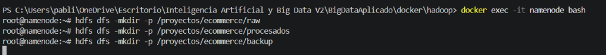

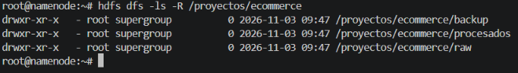
### 2. Carga inicial de logs

Desde tu sistema local, sube al directorio `/raw` los siguientes logs de un servidor Web Apache:

- [**Fichero de log 1**](https://vgonzalez165.github.io/apuntes_bda/practicas/ut02/access_log_20251002-131938.log)
- [**Fichero de log 2**](https://vgonzalez165.github.io/apuntes_bda/practicas/ut02/access_log_20251002-131952.log)
- [**Fichero de log 3**](https://vgonzalez165.github.io/apuntes_bda/practicas/ut02/access_log_20251002-132005.log)

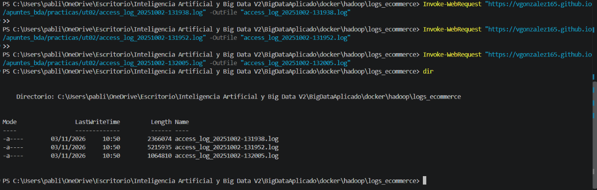
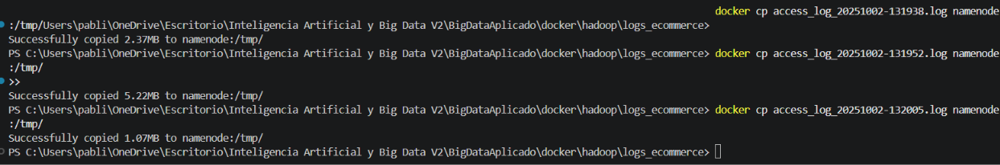
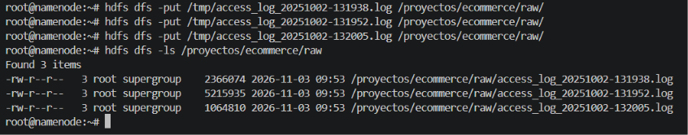

### 3. Inspección de datos

- Lista los archivos en `/raw` y visualiza su contenido.
- Muestra el número total de líneas en cada archivo subido.
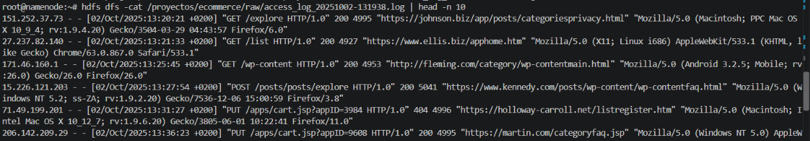
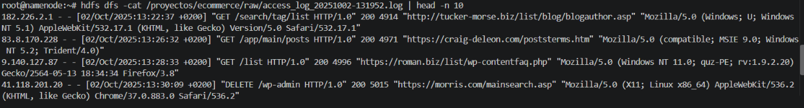
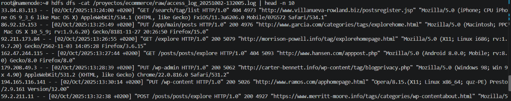

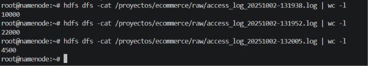

### 4. Organización de los logs

- Copia los archivos de `/raw` a `/backup`.
  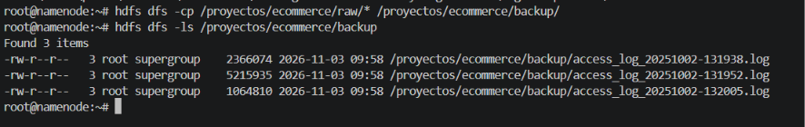
- Mueve los archivos originales de `/raw` a `/procesados`.
  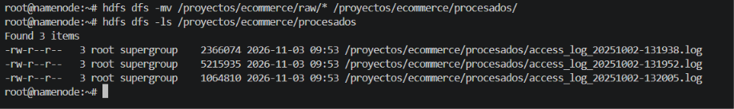

### 5. Acceso compartido para analistas

- Verifica los permisos actuales de `/proyectos/ecommerce`.
  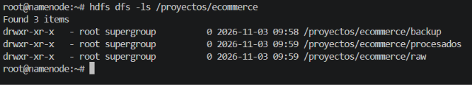
- Cambia los permisos de `/procesados` para que todos los usuarios tengan solo permisos de lectura, pero no de escritura ni eliminación.
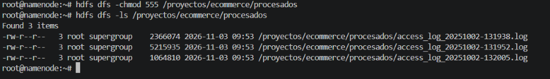
### 6. Simulación de trabajo con analistas

- Descarga desde HDFS uno de los archivos de `/procesados` a tu sistema local para compartirlo externamente.
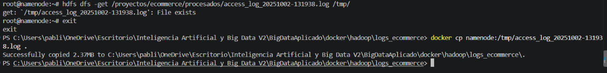
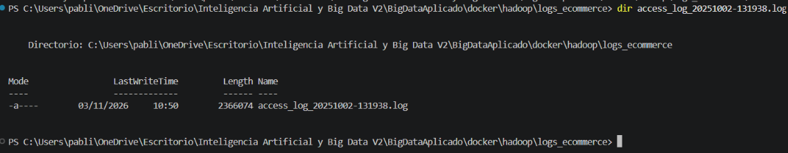

### 7. Mantenimiento y limpieza

- Sube un archivo temporal al directorio `/raw`.
  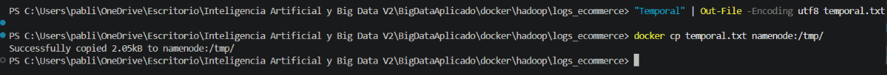
  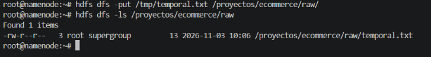
- Elimínalo de HDFS para mantener el espacio limpio.
  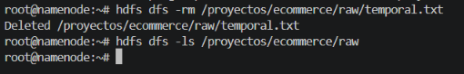

### 8. (Opcional, avanzado)

- Configura una cuota de espacio en `/backup` (ejemplo: 10 MB).
  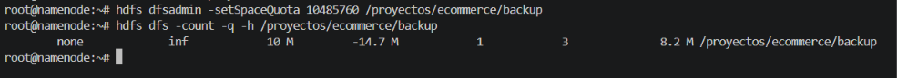
- Intenta subir archivos hasta alcanzar el límite y observa el comportamiento del sistema.
  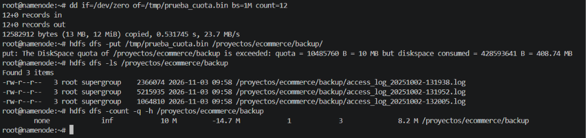

## Entrega

Un **documento** que incluya:

- Comando introducido en cada uno de los ejercicios.
- Una muestra de las primeras líneas de la salida.

---

[**Volver al índice**](https://vgonzalez165.github.io/apuntes_bda/)